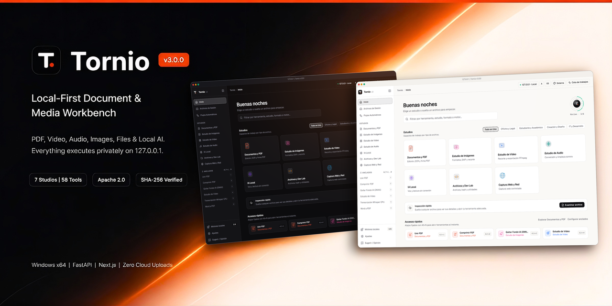

  

 

# Albert Dilas

**Software & AI Systems Engineer** · Lima, Peru

Designing local-first desktop software, autonomous AI workflows, and production-focused web applications engineered for speed, reliability, and data sovereignty.

 

---

### Core Engineering Areas

- **AI Systems & Autonomous Agents**: Multi-agent orchestration, local CPU/ONNX inference pipelines (`faster-whisper`, `U2NetP`), deterministic verification loops, and RAG architectures.
- **Local-First Desktop & Systems Architecture**: Self-contained native applications running over `127.0.0.1` with zero telemetry, cryptographic update verification (`SHA-256`), and hop-by-hop network security (`Anti-SSRF`).
- **Full-Stack & Native Packaging**: Python (`FastAPI`, `Pytest`), TypeScript (`Next.js`, Finite State Machines, `WebGL` / `Three.js`), and deterministic builds (`PyInstaller`, `Inno Setup`, `Playwright E2E`).

---

### Stack & Tooling

---

### Open-Source & Production Systems

| System | Description & Architecture | Status |
| :--- | :--- | :--- |
| **[Tornio](https://github.com/albert-dilas/Tornio)** | **Local-First Media & Document Workbench** (`FastAPI / Next.js / FFmpeg / ONNX`) 58 offline tools across 7 Studios (PDF & OCR, Video, Audio, Images, Crypto Vault, Local CPU AI, Anti-SSRF Web Capture) running on `127.0.0.1` with `SHA-256` verified updates. | **`v3.0.0`** · Apache 2.0 [Interactive 3D Site](https://albert-dilas.github.io/Tornio/) · [Releases](https://github.com/albert-dilas/Tornio/releases/tag/v3.0.0) |
| **Voice, Reading & Agent Tooling** | Private offline text-to-audio synchronization, soundscape engines, and autonomous systems currently in active engineering. | In Development |

 

  

---

### Engineering Principles

1. **Privacy by Architecture**: User files and sensitive computation belong on the user's hardware whenever possible.
2. **Explicit State & Zero Silent Failures**: Finite state modeling on the frontend paired with strict boundary validation and automated end-to-end verification on the backend.
3. **Production-Ready Distribution**: Software should install cleanly without intrusive privileges and verify its own integrity automatically.
